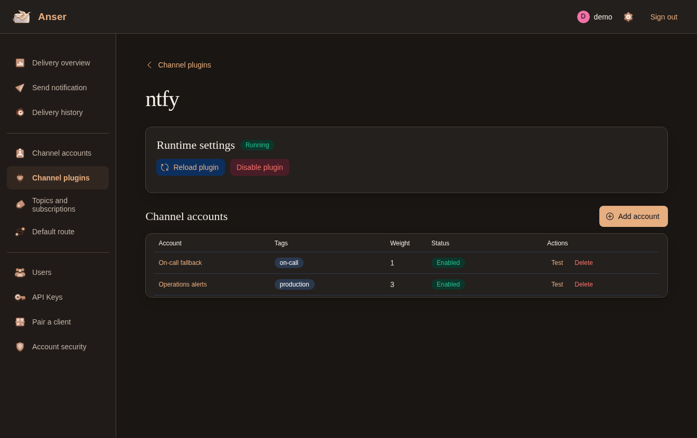

# Anser

Anser is a self-hosted notification hub. Use one API to send messages to topics, channel accounts, or the Anser client. The server embeds an Elastic UI console. The standalone NSH client uses native components for connecting, receiving, sending, and inspecting deliveries.

[简体中文](README.md) · [Download](https://github.com/ca-x/anser/releases/latest) · [Screenshots](#screenshots) · [Configuration](#configuration)

The server binary, Docker images, and NSH client come in separate archives. Verify downloads against the `SHA256SUMS` file for the same release.

## Run the server

Docker Compose can build the server and its embedded console from source. Set both bootstrap variables to create the first administrator.

```sh
export ANSER_BOOTSTRAP_USERNAME=admin
read -rsp 'Anser administrator password: ' ANSER_BOOTSTRAP_PASSWORD
echo
export ANSER_BOOTSTRAP_PASSWORD
docker compose up --build -d
unset ANSER_BOOTSTRAP_PASSWORD
```

Sign in at `http://127.0.0.1:8080/login` to open the console at `/admin`. Starting the server again with the same SQLite database preserves the administrator. For a deployment behind an HTTPS reverse proxy, set `ANSER_PUBLIC_URL=https://anser.example.com` so pairing codes use that address. The Docker volume holds the database and its master key file.

To use a prebuilt image, download the archive for your architecture and import it with `docker load -i anser-docker-linux-amd64.tar.gz`. The imported image is tagged `anser:<version>`.

You can also download a standalone server binary or build it with Node.js 24 and Rust 1.94.

```sh
npm --prefix clients/web ci
npm --prefix clients/web run build
ANSER_REQUIRE_WEB=1 cargo build --locked --release -p anser-server
./target/release/anser serve
```

Set `ANSER_BOOTSTRAP_USERNAME` and `ANSER_BOOTSTRAP_PASSWORD` before running the binary for the first time. You can also set a high-entropy `ANSER_BOOTSTRAP_API_KEY` for the initial administrator API key. The server binary includes the console assets and needs a writable data directory.

## Use the client

Enter the server address and your credentials on the connection screen. The console can generate a one-time pairing code with a two-minute lifetime. Scan it with your phone's camera and confirm sign-in in Anser. Each subscriber to a topic receives their own notification. Signed-in users can also send a notification directly to another username.

Users can turn on two-factor authentication in their account security settings. After linking an authenticator, password sign-in also requires a one-time authenticator code or a recovery code. Save the recovery codes when you finish setup. They appear once.

- [Build and package the NSH client](clients/nsh/README.md)
- [Develop the server console](clients/web)
- [SQLite, consistency, and recovery](docs/storage.md)

## Screenshots

The delivery overview shows the queue, successful deliveries, dead letters, and retries. These screenshots use the English interface and sample data.


<details>
<summary>Server plugin and account security settings</summary>




</details>

<details>
<summary>Native Linux client</summary>


</details>

Choose English or Simplified Chinese and a light, dark, or system theme from the gear menu on the sign-in page or in the console. The NSH client has the same options in Preferences. Each browser or device remembers its own choices.

## API and channels

- The server exposes OpenAPI at `/v1/openapi.json` and a health check at `/healthz`.
- Administrators can open a plugin's settings in the console or NSH client to enable it, disable it, reload it, or configure its accounts. Disabled plugins stay disabled after restart, and new deliveries skip their accounts.
- `POST /v1/send` and `POST /v1/topics/{name}/publish` durably queue messages and accept `Idempotency-Key` and `?wait=true`. Send API keys in `Authorization: Bearer ...`.
- `GET /v1/messages/{id}` shows deliveries and their attempts. The console supports broadcast, priority failover, weighted selection, weighted failover, rate limits, and retry backoff.
- The Rust SDK covers typed message submission, topic subscriptions, status queries, sign-in, and the inbox. Use `anser api --help` to find commands such as `anser api channels ntfy --action disable`. [Rust SDK](crates/anser-sdk)
- Available channels include ntfy, ServerChan, Bark, SMTP email, LazyCat, WeChat Official Account, WeCom, Lark, and Telegram. PushPlus and gorush served as design references. [Channel setup](anser-plugins) · [LazyCat setup](docs/lazycat.md)

## Configuration

| Environment variable | Default or purpose |
| --- | --- |
| `ANSER_BIND` | `127.0.0.1:8080`, or `0.0.0.0:8080` inside the container |
| `ANSER_DATABASE` | `anser.sqlite3` |
| `ANSER_BOOTSTRAP_USERNAME` / `ANSER_BOOTSTRAP_PASSWORD` | Initial administrator credentials. Passwords must be 8 to 256 UTF-8 bytes. |
| `ANSER_BOOTSTRAP_API_KEY` | Optional initial API key with at least 32 high-entropy characters |
| `ANSER_MASTER_KEY_FILE` / `ANSER_MASTER_KEY` | Optional 32-byte key encoded as URL-safe Base64. Anser creates a `.key` file alongside the database by default. |
| `ANSER_PUBLIC_URL` | HTTPS origin to advertise in mobile pairing codes |
| `ANSER_CORS_ORIGINS` | Comma-separated browser origins allowed to use the API |
| `ANSER_ALLOW_PRIVATE_NETWORK` / `ANSER_OUTBOUND_ALLOW_HOSTS` | Allow private network access as required by a self-hosted channel. It is restricted by default. |
| `ANSER_CALLBACK_ALLOW_HOSTS` / `ANSER_ATTACHMENT_ALLOW_HOSTS` | Comma-separated private hosts allowed for callbacks and attachments, respectively |
| `ANSER_WORKERS` / `ANSER_CONCURRENCY` | 4 queue workers and 32 concurrent sends |
| `ANSER_CHANNEL_CONCURRENCY` / `ANSER_ACCOUNT_CONCURRENCY` | 8 concurrent sends per channel and 1 per account |
| `ANSER_MAX_TTL_SECONDS` / `ANSER_RETENTION_DAYS` | 86,400-second TTL limit and 30-day record retention |
| `ANSER_QUEUE_LIMIT` / `ANSER_REQUESTS_PER_MINUTE` | 10,000 pending routes and 120,000 requests per credential per minute |

The Rust workspace, Web console, and NSH client share one `x.y.z` version. A matching `vX.Y.Z` tag builds Linux amd64 and arm64 images for GHCR and publishes Docker archives, server binaries, NSH packages, and SHA-256 checksums to GitHub Releases.
