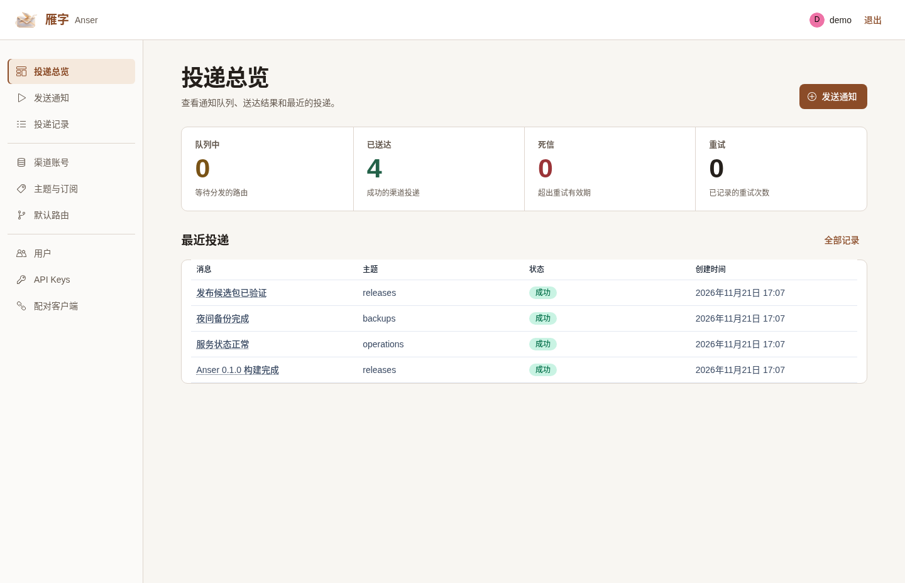
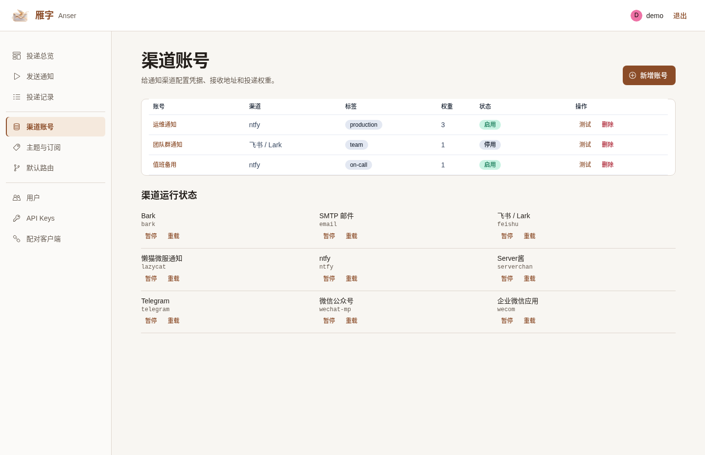
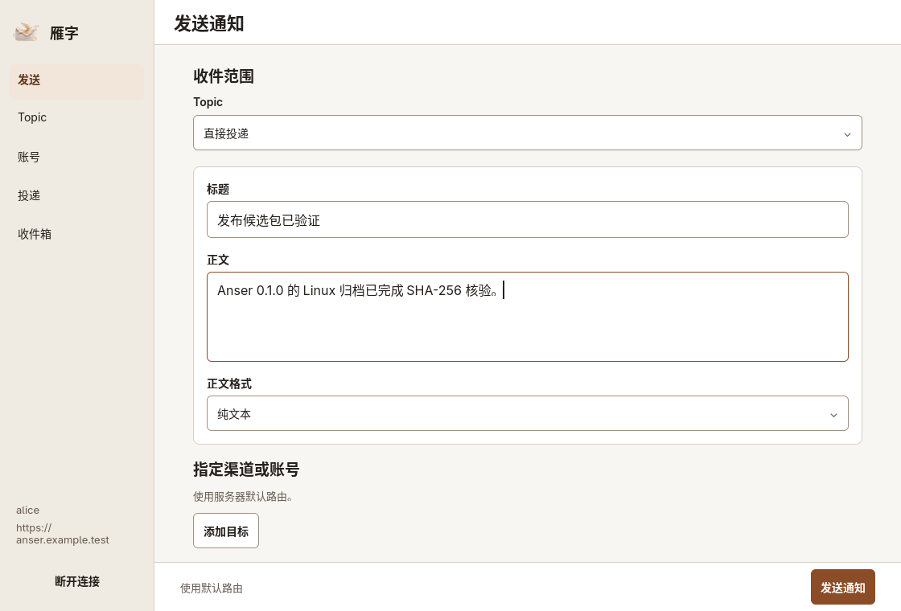

<p align="center"></p>

# 雁字 Anser

雁字是自托管通知聚合与分发应用。用统一 API 将消息投递到 Topic、渠道账号或 Anser 原生客户端。服务端自带 Elastic UI 管理台，NSH 客户端独立安装，用原生组件处理连接、通知、发送和投递记录。

## 界面截图

### 服务端管理台

投递总览和渠道账号页面，使用本地演示数据。





### NSH 原生客户端

Linux 客户端的通知发送页。



## 启动服务端

Docker Compose 可从源码构建服务端和内置前端。首次启动通过环境变量创建管理员。

```sh
export ANSER_BOOTSTRAP_USERNAME=admin
read -rsp 'Anser 管理员密码：' ANSER_BOOTSTRAP_PASSWORD; echo
export ANSER_BOOTSTRAP_PASSWORD
docker compose up --build -d
unset ANSER_BOOTSTRAP_PASSWORD
```

访问 `http://127.0.0.1:8080/login` 登录，管理界面位于 `/admin`。同一 SQLite 数据库上的后续启动不会重置管理员。生产环境可用 HTTPS 反向代理，设置 `ANSER_PUBLIC_URL=https://anser.example.com` 生成移动端配对二维码。Docker 镜像使用持久卷保存数据库与主密钥文件。

也可下载独立服务端二进制，或使用 Node.js 24 和 Rust 1.94 从源码构建。

```sh
npm --prefix clients/web ci
npm --prefix clients/web run build
ANSER_REQUIRE_WEB=1 cargo build --locked --release -p anser-server
./target/release/anser serve
```

设置 `ANSER_BOOTSTRAP_USERNAME` 和 `ANSER_BOOTSTRAP_PASSWORD` 后再首次执行二进制。也可用 `ANSER_BOOTSTRAP_API_KEY` 配置高熵初始管理员 API Key。Web 静态文件已编入发行二进制，运行时只需该二进制与数据目录。

## 使用客户端

连接页输入服务端地址和用户账号。在服务端管理台可生成两分钟内有效的一次性二维码，使用手机系统扫码打开 Anser 并确认登录。已经订阅同一 Topic 的用户各自获得一条原生通知。已登录用户也可按用户名发送原生通知。

- [NSH 客户端构建、打包与通知支持](clients/nsh/README.md)
- [Web 管理台开发](clients/web)
- [SQLite、一致性与恢复](docs/storage.md)

## API 与渠道

- API 文档由服务端提供在 `/v1/openapi.json`。健康检查在 `/healthz`。
- `POST /v1/send` 或 `POST /v1/topics/{name}/publish` 持久化入队，支持 `Idempotency-Key` 和 `?wait=true`。API Key 使用 `Authorization: Bearer ...`。
- `GET /v1/messages/{id}` 查看路由投递和历史尝试。管理台可配置广播、有序故障转移、按权重选择、加权首选再故障转移、限流和退避。
- [Rust SDK](crates/anser-sdk) 支持类型化发送、Topic 订阅、查询、登录及收件箱。CLI 用 `anser api --help` 查看账号、Topic 和发送命令。
- 支持 [ntfy](anser-plugins/ntfy)、[Server酱](anser-plugins/serverchan)、[Bark](anser-plugins/bark)、[SMTP 邮件](anser-plugins/email)、[懒猫通知](docs/lazycat.md)、[微信公众号](anser-plugins/wechat-mp)、[企业微信应用](anser-plugins/wecom)、[飞书](anser-plugins/feishu)和 [Telegram](anser-plugins/telegram)。PushPlus 和 gorush 用作设计参考。

## 配置

| 环境变量 | 默认或用途 |
| --- | --- |
| `ANSER_BIND` | `127.0.0.1:8080`，容器内监听 `0.0.0.0:8080` |
| `ANSER_DATABASE` | `anser.sqlite3` |
| `ANSER_BOOTSTRAP_USERNAME` / `ANSER_BOOTSTRAP_PASSWORD` | 首次初始化管理员，密码 8 到 256 个 UTF-8 字节 |
| `ANSER_BOOTSTRAP_API_KEY` | 可选，首次初始化 API Key，至少 32 个高熵字符 |
| `ANSER_MASTER_KEY_FILE` / `ANSER_MASTER_KEY` | 可选，URL-safe Base64 编码的 32 字节密钥，默认在数据库旁生成 `.key` 文件 |
| `ANSER_PUBLIC_URL` | 管理台生成移动端配对二维码时使用的 HTTPS 地址 |
| `ANSER_CORS_ORIGINS` | 允许访问 API 的 Web 客户端来源，以逗号分隔 |
| `ANSER_ALLOW_PRIVATE_NETWORK` / `ANSER_OUTBOUND_ALLOW_HOSTS` | 默认限制访问内网，自建渠道按部署配置放行 |
| `ANSER_CALLBACK_ALLOW_HOSTS` / `ANSER_ATTACHMENT_ALLOW_HOSTS` | 分别允许回调和附件访问指定私网主机，以逗号分隔 |
| `ANSER_WORKERS` / `ANSER_CONCURRENCY` | 默认 4 个调度 worker、32 个并行发送 |
| `ANSER_CHANNEL_CONCURRENCY` / `ANSER_ACCOUNT_CONCURRENCY` | 默认单渠道 8、单账号 1 |
| `ANSER_MAX_TTL_SECONDS` / `ANSER_RETENTION_DAYS` | 默认 86400 秒上限、30 天记录保留 |
| `ANSER_QUEUE_LIMIT` / `ANSER_REQUESTS_PER_MINUTE` | 默认 10000 个待处理路线、每凭据每分钟 120000 次请求 |

保持 `Cargo.toml`、Web 和 NSH 客户端版本为同一 `x.y.z` 值。GitHub Actions 在匹配的 `vX.Y.Z` 标签构建 GHCR 的 Linux amd64/arm64 镜像、服务端多平台归档以及独立 NSH 客户端包，随 GitHub Release 发布 SHA-256。
